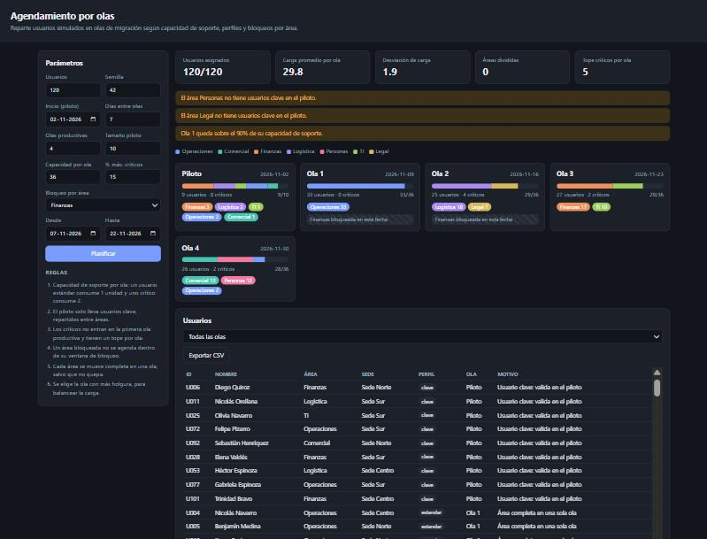
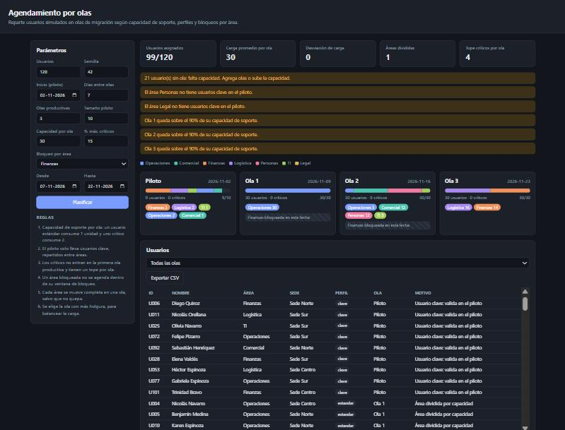

# Agendamiento por olas

Demo de cómo **repartir usuarios en olas** de una migración o despliegue (por ejemplo, el cambio de correo, de intranet o de ERP) respetando la **capacidad de soporte** del equipo, los **perfiles** de usuario y las **ventanas en que un área no puede detenerse**.

**[Ver demo en vivo](https://alansch7.github.io/agendamiento-por-olas/)**

> Los usuarios se **generan al azar** con una semilla fija: nombres, áreas y sedes son ficticios.



## El problema

En una migración, decidir quién pasa y cuándo suele hacerse a mano en una planilla. El resultado son olas desbalanceadas que saturan a la mesa de ayuda, áreas partidas en varias fechas y usuarios críticos migrados el primer día, justo cuando el proceso todavía no está probado. Esta demo convierte esos criterios en reglas explícitas y genera un plan que se puede explicar usuario por usuario.

## Qué muestra

- **Una ola piloto y N olas productivas**, con su fecha, su carga de soporte y el desglose por área.
- **KPIs del plan**: usuarios asignados, carga promedio, desviación de carga entre olas y áreas que hubo que dividir.
- **Advertencias**: usuarios sin cupo, olas sobre el 90% de capacidad y áreas sin representante en el piloto.
- Tabla de usuarios con la ola asignada y **el motivo de cada asignación**, exportable a CSV.

Cambia los parámetros (cantidad de usuarios, capacidad, número de olas, bloqueos) y el plan se recalcula.

## Reglas de distribución

1. **Capacidad en unidades de soporte.** Un usuario estándar o clave consume 1 unidad y uno crítico consume 2, porque requiere acompañamiento.
2. **El piloto solo lleva usuarios clave**, tomados por turnos de cada área para que todas validen antes del despliegue masivo.
3. **Los usuarios críticos no van en la primera ola productiva.** Esperan a que el proceso esté estabilizado y tienen un **tope por ola** (% de la capacidad).
4. **Bloqueos por área.** Un área en ventana de bloqueo (por ejemplo, Finanzas en cierre contable) no se agenda en esas fechas.
5. **Cohesión de área.** Cada área se mueve completa en una sola ola y solo se divide si no cabe en ninguna.
6. **Balance de carga.** Entre las olas válidas se elige la de **más holgura**, no la primera disponible. Así se evita una primera ola saturada y una última vacía.

Los críticos se agendan después de las áreas y, si se puede, en la misma ola que el resto de su área.

## Decisiones de diseño

| Decisión | Por qué |
|---|---|
| **Heurística greedy en lugar de un optimizador** | Con decenas o cientos de usuarios, una regla del tipo "la ola más holgada que cumpla todo" da planes buenos, rápidos y, sobre todo, **explicables**: cada usuario lleva el motivo de su asignación. |
| **Áreas de mayor a menor** | Como en el *bin packing* "first-fit decreasing": ubicar primero los bloques grandes deja los huecos para los chicos y reduce las divisiones. |
| **Peso por perfil** | La restricción real no es "cantidad de personas", sino "cuánta atención puede dar la mesa de ayuda ese día". |
| **Semilla fija** | Los mismos parámetros siempre producen el mismo plan, lo que facilita comparar escenarios y testear. |
| **Lógica pura y testeada** | `src/olas.js` no toca el DOM. Los tests verifican las invariantes: nadie queda dos veces, no se excede la capacidad, se respetan los bloqueos y los topes de críticos. |

## Resultado (con datos de ejemplo)

> Las cifras de esta sección salen de **usuarios simulados** (generados con la semilla 42), no de una migración real. Sirven para mostrar cómo se comporta el planificador.

Con la configuración por defecto (120 usuarios simulados, piloto + 4 olas, capacidad de 36 unidades por ola, Finanzas bloqueada por cierre contable):

- Los **120 usuarios quedan asignados** y **ninguna área se divide**.
- La carga queda en 28–33 unidades por ola, con una **desviación de 1,9**.
- Finanzas cae en la primera ola fuera de su ventana de bloqueo, y ninguna ola supera el tope de críticos.

Si se reduce la capacidad (3 olas de 30 unidades), el plan no oculta el problema: avisa que **21 usuarios quedan sin ola** y qué olas están sobre el 90%.



Estas invariantes están cubiertas por 10 tests automatizados.

## Cómo usarlo

Abre `index.html` en el navegador (o la versión de GitHub Pages). No requiere instalación.

```bash
npm test   # Node 18+, sin dependencias
```

## Estructura

```
index.html        interfaz
src/olas.js       generador de usuarios + planificador (puro)
tests/            tests de invariantes con node:test
```

## Licencia

MIT
